# 📚 Toko Buku Online (Tugas Pemrograman Web)

Aplikasi web e-commerce berbasis client-side untuk manajemen katalog buku, pemesanan (checkout), pelacakan pengiriman (tracking), serta riwayat transaksi. Proyek ini dikembangkan menggunakan HTML5, CSS3, dan JavaScript murni.

---

## 🚀 Fitur Utama

1. **Sistem Autentikasi (Login & Register)**:
   - Validasi login pengguna (User dan Admin) dengan penyimpanan sesi (`sessionStorage`).
   - Fitur pendaftaran akun baru dengan validasi format email dan panjang password.
   - Fitur reset/lupa password interaktif.
2. **Dashboard Interaktif**:
   - Sapaan dinamis berdasarkan waktu lokal pengguna (Pagi, Siang, Sore, Malam).
   - Penunjuk **Jam, Tanggal, dan Bulan *Realtime*** yang berjalan otomatis tiap detik.
   - Menu navigasi utama berbasis grid card.
3. **Informasi Stok & Katalog Buku**:
   - Menampilkan daftar katalog buku lengkap dengan cover, kode, nama, jenis, edisi, stok, dan harga.
   - **Indikator Stok Rendah**: Buku dengan jumlah stok di bawah 200 ditandai dengan warna merah secara otomatis.
   - Fitur tambah stok buku baru secara dinamis dengan validasi input.
4. **Laporan Pemesanan & Checkout**:
   - Memilih buku dari katalog dan mengatur jumlah pesanan dengan pengecekan batas stok.
   - Tabel keranjang belanja interaktif yang otomatis menghitung subtotal dan total bayar.
   - Form data pemesan (nama, email terisi otomatis dari akun login, nomor telepon, ekspedisi, metode pembayaran, dan alamat).
   - Menghasilkan **Nomor Delivery Order (DO)** unik secara otomatis setelah pesanan dibuat.
5. **Tracking Pengiriman**:
   - Melacak posisi paket secara real-time berdasarkan Nomor Delivery Order (No. DO).
   - Dilengkapi dengan progress bar, status pengbadge, dan riwayat perjalanan paket (log tracking).
6. **History Transaksi**:
   - Modal pop-up riwayat seluruh transaksi pemesanan yang pernah dilakukan.

---
## Screeshot hasil praktik
Screenshot hasil praktikum 
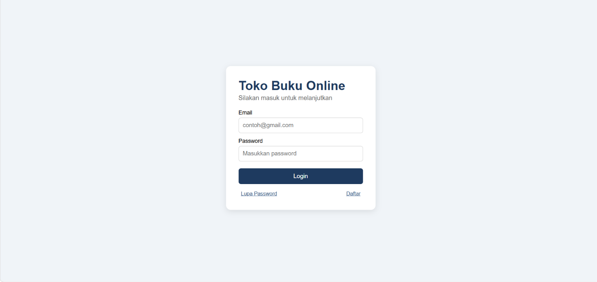
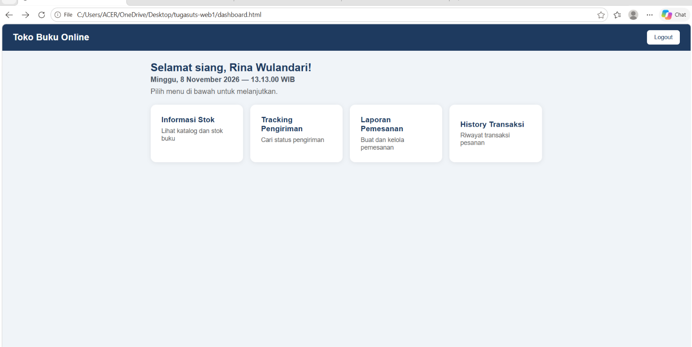
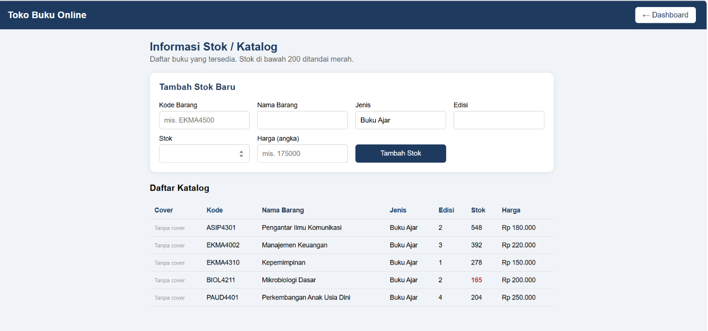
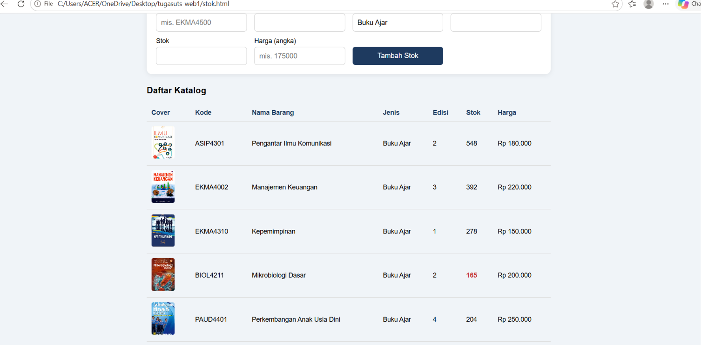
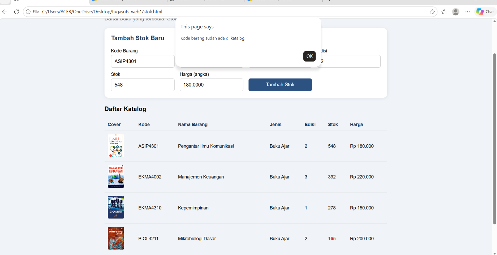

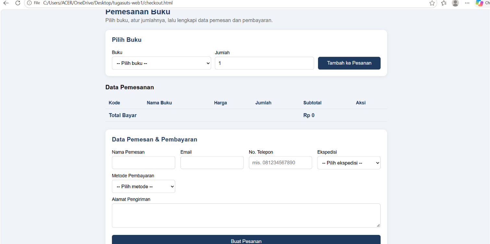
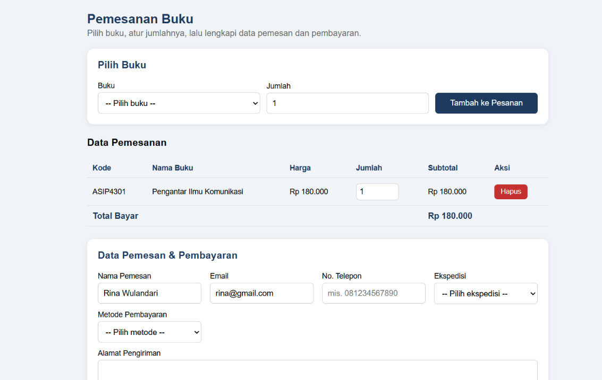
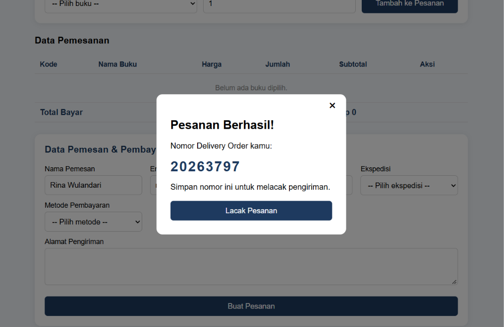
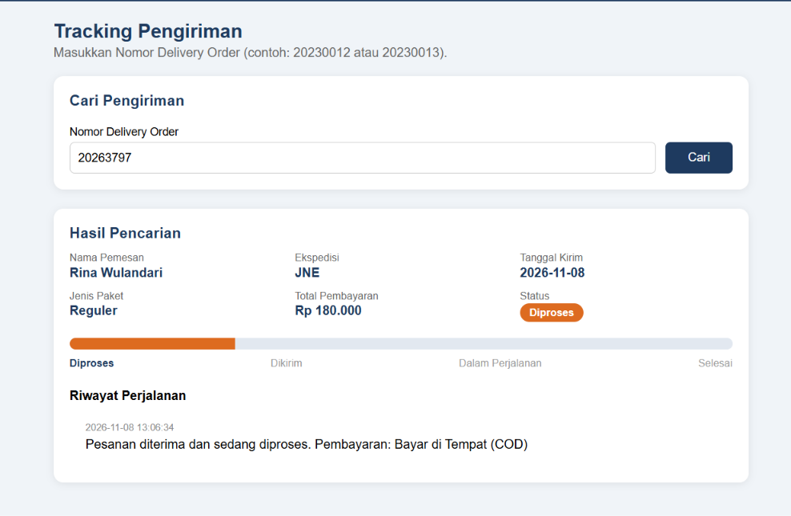
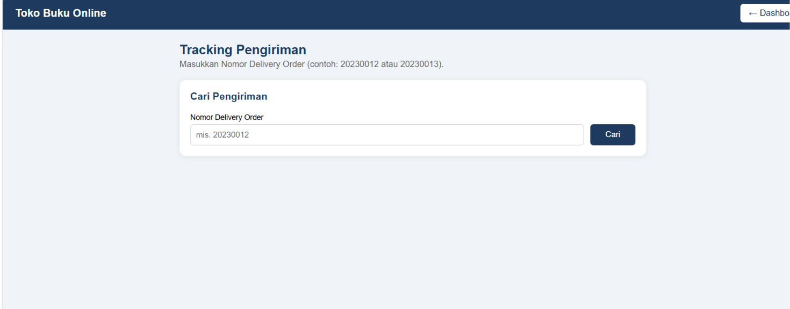
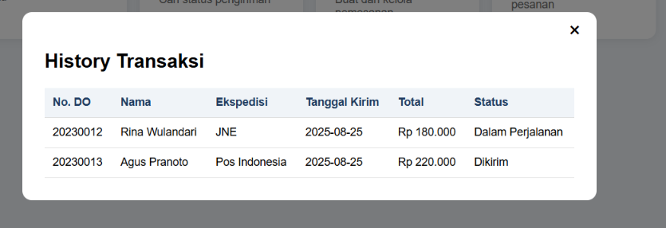
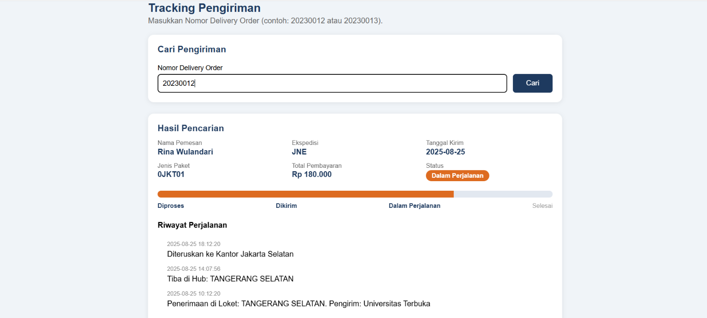

## 📂 Struktur Folder Project

Pastikan struktur direktori di komputer kamu tersusun seperti ini agar seluruh file CSS, JS, dan path gambar terhubung dengan benar:

```text
tugasuts-web1/
│
├── css/
│   └── style.css
│
├── js/
│   ├── data.js
│   └── script.js
│
├── img/                  <-- (Folder opsional untuk menyimpan asset cover buku)
│   ├── pengantar_komunikasi.jpg
│   ├── manajemen_keuangan.jpg
│   └── ...
│
├── index.html            <-- Halaman Utama / Login
├── dashboard.html        <-- Halaman Dashboard Menu Utama
├── stok.html             <-- Halaman Informasi Stok & Katalog Buku
├── checkout.html         <-- Halaman Laporan Pemesanan & Checkout
└── tracking.html         <-- Halaman Pelacakan Pengiriman (Tracking)